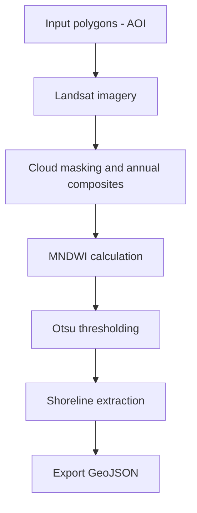

# ShoreLIM
shoreLIM is a easy Python tool designed to run in GoogleColab for extracting annual shorelines from composite satellite imagery acquired by Landsat 5, 7, 8, and 9. 
The tool processes imagery over a user-defined area of interest (AOI), supports shoreline delineation using commonly used spectral indices, and applies the marching squares algorithm to achieve sub-pixel shoreline positioning.

